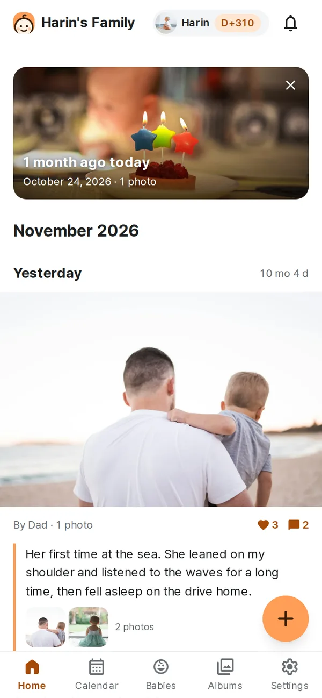
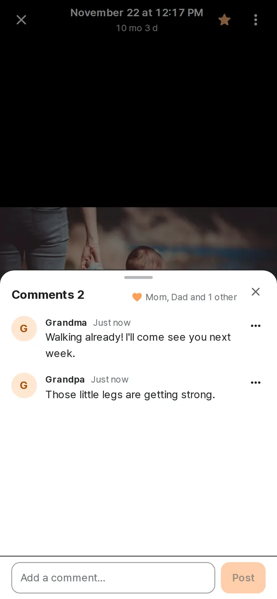
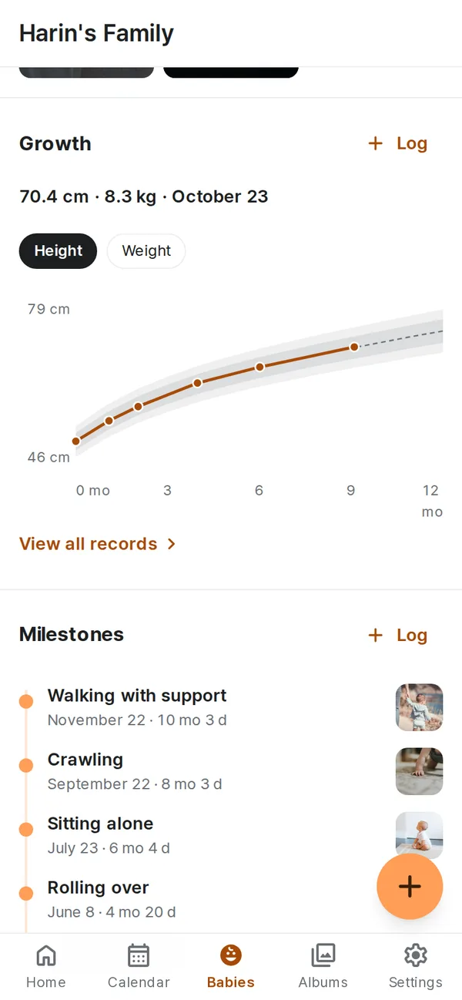
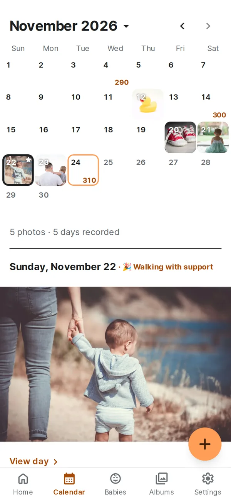

<p align="center">
  
</p>

<p align="center">
  <a href="README.md">한국어</a> | <b>English</b>
</p>

<p align="center">
  <a href="https://github.com/youngtaeju/Chagokmoa/releases/latest"></a>
  <a href="LICENSE"></a>
  <a href="https://chagokmoa.com/en/"></a>
</p>

<p align="center">
  <b>Chagokmoa is inspired by a Korean expression meaning "to gather and keep things neatly, one by one."</b><br>
  A growth album of your child that your whole family keeps together.<br>
  Keep photos, videos, and precious moments on a server you run yourself.
</p>

<p align="center">
  
  
  
  
</p>

## Features

### Photos and videos

- Upload many photos and videos at once, and resume if an upload is interrupted. Duplicate files are not stored twice.
- HEIC photos and phone videos are supported. Originals are kept byte for byte, and thumbnails and web playback files are created separately.
- Timeline by capture date, full-screen viewer, and original downloads.
- Deleted photos can be restored from the trash.

### Family

- Family members join through invite links. Roles are Admin, Guardian (uploads photos and manages child info), and Family (views and reacts).
- Talk with hearts, comments, and mentions, and save the photos you love to favorites.
- Get web push notifications for new photos, comments, mentions, stories, and milestones.

### Records

- See each child's profile with age in days and months, and keep records for more than one child.
- Record stories (text and photos), height and weight, and growth milestones such as rolling over, first steps, and the first tooth.
- See height and weight on growth charts together with the WHO growth standard curves.

### Browse

- Find photos by date on the calendar, and revisit memories from a year or a few months ago today.
- Gather photos into albums by theme. Albums by month of age are created automatically.

### Operations

- Runs on a home server or NAS with a Docker image and PostgreSQL.
- Set up encrypted backups with restic (local folder and remote repository) and restore in the app.
- Optionally connect SMTP mail (invites, password resets) and OIDC sign-in (Authentik, Keycloak, Google, and others).
- When a new version is released, it is shown on the admin's settings screen.
- Dark mode, Korean, and English.

## Browser and home screen app

Open your server address and start using it right in the browser. Chagokmoa is a PWA (Progressive Web App), so you can install it on your phone or computer without an app store and use it in its own app window.

- **iPhone, iPad:** In Safari, open the Share menu and choose "Add to Home Screen"
- **Android:** In the Chrome menu, choose "Install app" or "Add to Home screen"
- **Computer:** The install icon in the Chrome or Edge address bar

Turn on push notifications per device in `Settings → Notifications`. On iPhone and iPad, web push notifications work through the app added to the home screen on iOS/iPadOS 16.4 or later.

PWA installation and push notifications generally require HTTPS. localhost is treated as a secure context exception for local development.

### Supported browsers

- **Desktop:** Chrome, Edge, Firefox, Safari
- **Mobile:** iOS/iPadOS Safari, Android Chrome

Using the latest stable version is recommended. Support for PWA installation and web push notifications may vary by browser and operating system.

In browsers without `Intl.supportedValuesOf`, the time zone picker shows only the current time zone.

## Installation

Run it on a server with Docker and Docker Compose (a home server, NAS, and so on). The image is `ghcr.io/youngtaeju/chagokmoa` and supports `linux/amd64`. The only external dependency is PostgreSQL, which is included in the compose file.

1. Copy `docker-compose.yml` and `.env.example` from the `compose/` directory to a working directory on your server, rename `.env.example` to `.env`, and fill in the values.

   - `SECRET_KEY`: 64 hex characters generated with `openssl rand -hex 32`.
   - `POSTGRES_PASSWORD`: The database password. It must match the password inside `DATABASE_URL`. Alphanumeric characters are recommended; special characters must be URL-encoded in `DATABASE_URL`.
   - `PUBLIC_URL`: The address you open in the browser. Behind a reverse proxy, use its https address.
   - `PUID`, `PGID`: The host user that owns the `./data` directory. Check them on the host with `id -u` and `id -g`.

2. Start it.

   ```bash
   docker compose up -d
   ```

   Database migrations are applied automatically on startup. Originals and derived files are stored in `./data`, and the database in `./postgres`.

3. Open the `PUBLIC_URL` address (default `http://localhost:8080`) in the browser and sign up. The first account becomes the Admin (owner). Other family members join through invite links created by the Admin.

The compose `ports` setting opens the port on all host interfaces. If a reverse proxy runs on the same host, bind to `127.0.0.1` only.

```yaml
    ports:
      - "127.0.0.1:${PORT:-8080}:8080"
```

For reverse proxies, https, backups, mail, and OIDC sign-in, see the [operations guide](docs/operations.md) (in Korean).

### Upgrading

When a new version is released, it appears next to the app version on the admin's settings screen. The server checks GitHub releases for the latest version; you can turn this off in Settings → System → General.

Change `CHAGOKMOA_VERSION` in `.env` to the new version, then run the command below. If you use the default `latest`, run it without changing the value.

```bash
docker compose pull && docker compose up -d
```

New migrations are applied automatically on startup. Back up before upgrading ([backups](docs/operations.md#백업), in Korean).

## License

Copyright (C) 2026 youngtaeju

AGPL-3.0-only. See [LICENSE](LICENSE).

The Docker image bundles third-party packages, each under its own license. For example, Debian's ffmpeg links GPL components (x264, x265, and others), and the image also includes libheif. Sources for these packages are available from Debian.

The growth chart reference curves embed the WHO Child Growth Standards tables, reduced to monthly values. The tables themselves carry no explicit license, so they are treated under CC BY-NC-SA 3.0 IGO (non-commercial), the license of WHO publications. The source and terms are in [web/src/growth/who/NOTICE.md](web/src/growth/who/NOTICE.md).
