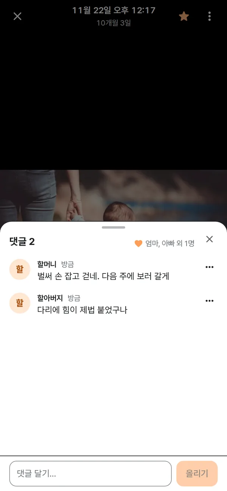
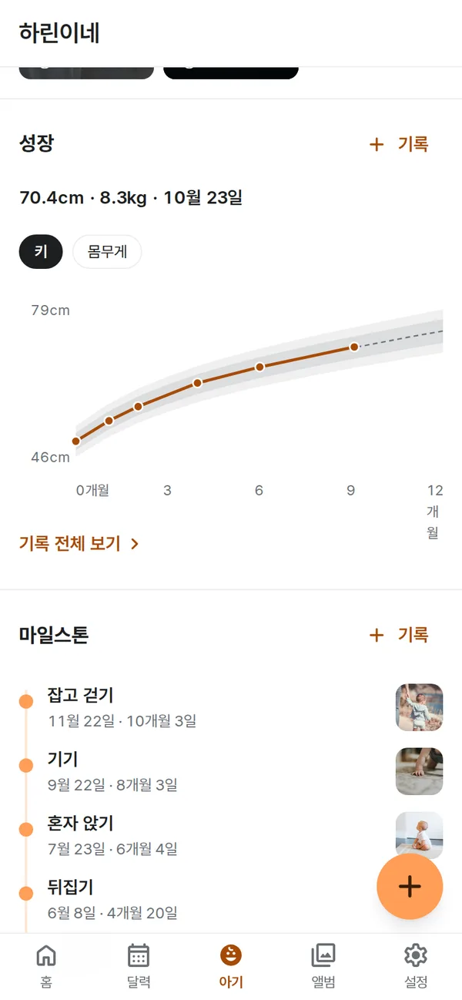
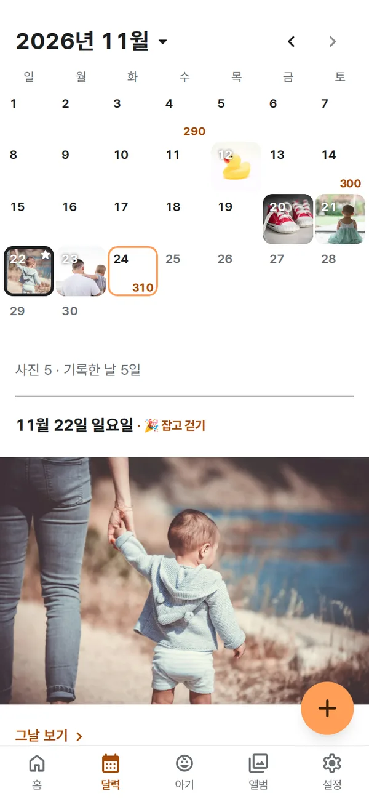

<p align="center">
  
</p>

<p align="center">
  <b>한국어</b> | <a href="README.en.md">English</a>
</p>

<p align="center">
  <a href="https://github.com/youngtaeju/Chagokmoa/releases/latest"></a>
  <a href="LICENSE"></a>
  <a href="https://chagokmoa.com"></a>
</p>

<p align="center">
  <b>차곡모아라는 이름은 "차곡차곡 모아 두다"에서 왔습니다.</b><br>
  우리 가족이 함께 기록하는 아이의 성장 앨범입니다.<br>
  사진과 영상, 소중한 순간들을 직접 운영하는 서버에 모아 둡니다.
</p>

<p align="center">
  
  
  
  
</p>

## 기능

### 사진과 영상

- 사진과 영상을 여러 개 한 번에 올리고, 업로드가 중단되어도 이어서 올릴 수 있습니다. 같은 파일은 중복 저장하지 않습니다.
- HEIC 사진과 휴대폰 영상을 지원합니다. 원본은 바이트 그대로 보관하고, 썸네일과 웹 재생용 파일은 별도로 생성합니다.
- 촬영일 기준 타임라인, 전체 화면 뷰어, 원본 다운로드를 제공합니다.
- 삭제한 사진은 휴지통에서 복구할 수 있습니다.

### 가족

- 가족은 초대 링크로 참여합니다. 역할은 관리자, 보호자(사진 업로드 및 아이 정보 관리), 가족(조회 및 반응)으로 구분됩니다.
- 하트, 댓글, 멘션으로 소통하고, 마음에 드는 사진은 즐겨찾기에 담을 수 있습니다.
- 새 사진, 댓글, 멘션, 이야기, 마일스톤 소식을 웹 푸시 알림으로 받아볼 수 있습니다.

### 기록

- 아이의 프로필과 생후 일수, 개월 수를 확인하고, 여러 아이의 기록을 관리할 수 있습니다.
- 이야기(글과 사진), 키와 몸무게, 뒤집기, 첫걸음, 첫니 등의 성장 마일스톤을 기록합니다.
- 성장 차트에서 키와 몸무게를 WHO 성장 기준 곡선과 함께 확인할 수 있습니다.

### 둘러보기

- 달력에서 날짜별 사진을 찾고, 1년 전 오늘이나 몇 개월 전 오늘의 추억을 다시 볼 수 있습니다.
- 주제별 앨범으로 사진을 모아 두고, 생후 개월별 앨범은 자동으로 생성됩니다.

### 운영

- Docker 이미지와 PostgreSQL을 사용해 홈서버나 NAS에서 실행할 수 있습니다.
- restic 기반 암호화 백업(로컬 폴더 및 원격 저장소)과 복구를 앱에서 설정할 수 있습니다.
- SMTP 메일(초대, 비밀번호 재설정)과 OIDC 로그인(Authentik, Keycloak, Google 등)을 선택적으로 연동할 수 있습니다.
- 새 버전이 출시되면 관리자 설정 화면에 표시됩니다.
- 다크 모드와 한국어, 영어를 지원합니다.

## 브라우저와 홈 화면 앱

서버 주소로 접속하면 브라우저에서 바로 사용할 수 있습니다. PWA(Progressive Web App)를 지원해 별도의 앱 스토어 없이 휴대폰이나 PC에 설치하고, 독립된 앱 화면에서 사용할 수 있습니다.

- **iPhone, iPad:** Safari의 공유 메뉴에서 '홈 화면에 추가'
- **Android:** Chrome 메뉴에서 '앱 설치' 또는 '홈 화면에 추가'
- **PC:** Chrome 또는 Edge 주소창의 설치 아이콘

푸시 알림은 `설정 → 알림 설정`에서 기기별로 활성화할 수 있습니다. iPhone과 iPad에서는 iOS/iPadOS 16.4 이상에서 홈 화면에 추가한 앱을 통해 웹 푸시 알림을 받을 수 있습니다.

PWA 설치와 푸시 알림은 일반적으로 HTTPS 환경이 필요하며, localhost는 로컬 개발을 위한 보안 컨텍스트 예외로 취급됩니다.

### 지원 브라우저

- **데스크톱:** Chrome, Edge, Firefox, Safari
- **모바일:** iOS/iPadOS Safari, Android Chrome

최신 안정 버전 사용을 권장합니다. PWA 설치와 웹 푸시 알림 지원 여부는 브라우저와 운영체제에 따라 다를 수 있습니다.

`Intl.supportedValuesOf`를 지원하지 않는 브라우저에서는 시간대 선택 시 현재 시간대만 표시됩니다.

## 설치

Docker 와 Docker Compose 가 있는 서버(홈서버, NAS 등)에서 실행합니다. 이미지는 `ghcr.io/youngtaeju/chagokmoa` 이며 `linux/amd64` 를 지원합니다. 외부 의존은 PostgreSQL 하나이고 compose 에 포함되어 있습니다.

1. `compose/` 디렉터리의 `docker-compose.yml` 과 `.env.example` 을 서버의 작업 디렉터리에 복사하고, `.env.example` 을 `.env` 로 바꿔 값을 채웁니다.

   - `SECRET_KEY`: `openssl rand -hex 32` 로 만든 64자 16진수입니다.
   - `POSTGRES_PASSWORD`: DB 비밀번호입니다. `DATABASE_URL` 안의 비밀번호와 같은 값이어야 합니다. 영숫자를 권장하며, 특수문자는 `DATABASE_URL` 에서 URL 인코딩이 필요합니다.
   - `PUBLIC_URL`: 브라우저로 접속하는 주소입니다. 리버스 프록시 뒤라면 그 https 주소입니다.
   - `PUID`, `PGID`: `./data` 디렉터리를 소유할 호스트 사용자입니다. 호스트에서 `id -u`, `id -g` 로 확인합니다.

2. 실행합니다.

   ```bash
   docker compose up -d
   ```

   데이터베이스 마이그레이션은 기동할 때 자동으로 적용됩니다. 원본과 파생물은 `./data`, 데이터베이스는 `./postgres` 에 저장됩니다.

3. 브라우저에서 `PUBLIC_URL` 주소(기본 `http://localhost:8080`)를 열고 첫 가입을 합니다. 첫 번째로 가입한 계정이 관리자(owner)가 되며, 이후 가족은 관리자가 만든 초대 링크로 가입합니다.

compose 의 `ports` 는 호스트의 모든 인터페이스에 포트를 엽니다. 같은 호스트에서 리버스 프록시를 운영한다면 `127.0.0.1` 에만 바인딩합니다.

```yaml
    ports:
      - "127.0.0.1:${PORT:-8080}:8080"
```

리버스 프록시, https, 백업, 메일, 로그인(OIDC) 등 운영 안내는 [운영 문서](docs/operations.md)를 참고하십시오.

### 업그레이드

새 버전이 나오면 관리자의 설정 화면에서 앱 버전 옆에 표시됩니다. 서버가 GitHub 릴리스에서 최신 버전을 조회하며, 설정 → 시스템 → 일반에서 끌 수 있습니다.

`.env` 의 `CHAGOKMOA_VERSION` 을 새 버전으로 바꾼 뒤 다음을 실행합니다. 기본값 `latest` 를 쓰는 경우 값 변경 없이 실행합니다.

```bash
docker compose pull && docker compose up -d
```

새 버전의 마이그레이션은 기동할 때 자동으로 적용됩니다. 업그레이드 전에 백업을 권장합니다([백업](docs/operations.md#백업)).

## 라이선스

Copyright (C) 2026 youngtaeju

AGPL-3.0-only. [LICENSE](LICENSE) 참조.

Docker 이미지에는 서드파티 패키지가 함께 들어 있으며 각각의 라이선스를 따릅니다. 예를 들어 Debian 의 ffmpeg 는 GPL 구성요소(x264, x265 등)를 링크하고, 이미지에는 libheif 등도 포함됩니다. 해당 패키지의 소스는 Debian 에서 받을 수 있습니다.

성장 차트의 또래 성장 곡선은 WHO Child Growth Standards 표를 월 단위로 줄여 내장했습니다. 표 자체에는 라이선스 명시가 없어 WHO 출판물 기준인 CC BY-NC-SA 3.0 IGO(비상업)로 간주합니다. 출처와 이용 조건은 [web/src/growth/who/NOTICE.md](web/src/growth/who/NOTICE.md) 에 있습니다.
